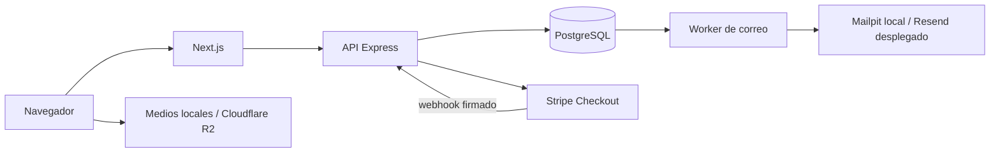

# Señor del Mictlán

Tienda de destilados de agave de Etúcuaro, Michoacán. Incluye landing y catálogo, cuentas, carrito, Stripe Checkout, pedidos y correo transaccional con un PDF de detalle de pedido.

## Empezar en local

Necesitas Git, Docker Engine y Docker Compose v2. Desde un clon limpio:

```bash
cp .env.example .env
docker compose up --build --detach --wait --wait-timeout 180
docker compose exec backend npm run prisma:migrate:deploy
docker compose exec -T postgres sh -c 'psql -v ON_ERROR_STOP=1 -U "$POSTGRES_USER" -d "$POSTGRES_DB"' < backend/prisma/dev-showcase.sql
```

Abre la tienda en http://localhost:3000 y Mailpit en http://localhost:8025. El SQL carga tres productos con precios de demostración sólo en la base local. La [guía de desarrollo](docs/development.md) explica requisitos, otros puertos, acceso LAN, imágenes, migraciones y diagnóstico. Puedes levantar la tienda sin cuentas de Stripe, Resend, Railway o Cloudflare; esas integraciones se preparan cuando llega su fase.

## Cómo se conectan las piezas



Compose ejecuta frontend, API, PostgreSQL, worker y Mailpit en desarrollo. Railway ejecuta frontend, API, worker y PostgreSQL por separado en staging y producción. La confirmación del pago depende del webhook firmado, no del retorno del navegador. Las imágenes se sirven desde el frontend local o desde R2 según el entorno.

## Guías de implementación

Sigue el [roadmap](docs/ROADMAP.md) para el orden y los criterios de cierre; el [alcance del MVP](docs/MVP_SCOPE.md) define las capacidades previstas.

| Necesidad | Guía |
|---|---|
| Clonar, arrancar Compose, usar dos proyectos, LAN o R2 opcional | [Desarrollo local](docs/development.md) |
| Cargar y resolver imágenes locales o en R2 | [Medios](docs/media.md) |
| Probar pagos locales y configurar webhooks publicados | [Stripe](docs/stripe.md) |
| Administrar registros del dominio en Neubox/cPanel | [Dominio y DNS](docs/domain-neubox-cpanel.md) |
| Verificar remitentes y configurar el envío real | [Resend](docs/resend.md) |
| Preparar Dockerfiles de producción y desplegar servicios | [Railway](docs/railway.md) |
| Consultar cuotas y tarifas con fecha de revisión | [Servicios y costos](docs/servicios-y-costos.md) |
| Consultar decisiones visuales | [Sistema visual](design.md) |

Los contratos de comportamiento están organizados por su fase de origen: [03 Landing y catálogo](docs/contracts/03-LANDING-CATALOG.md), [04 Cuentas](docs/contracts/04-ACCOUNTS-PROFILE.md), [05 Carritos](docs/contracts/05-CARTS.md), [06 Checkout y pedidos](docs/contracts/06-CHECKOUT-ORDERS.md) y [07 Correo de compra y PDF](docs/contracts/07-PURCHASE-EMAIL-PDF.md).

Las claves de terceros, contraseñas y URLs de cada entorno se configuran fuera de Git. `.env.example` contiene la base local y ejemplos opcionales; nunca publiques `.env` ni copies datos reales a staging.
