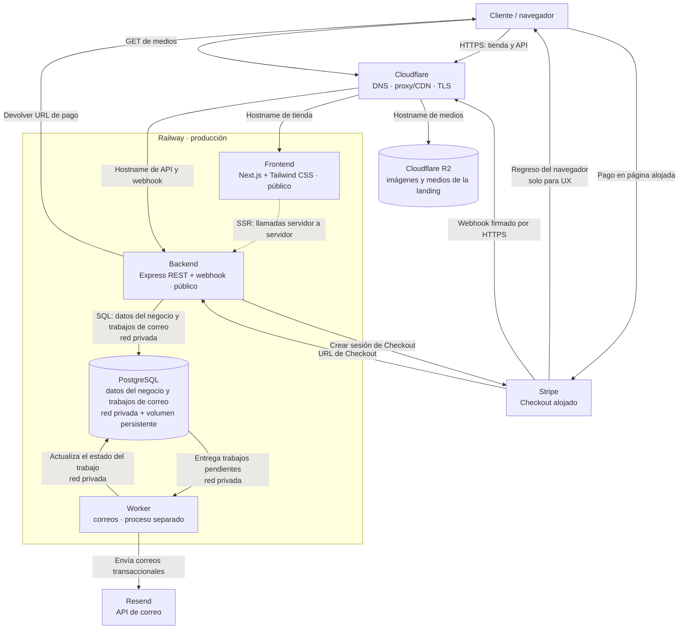

# Señor del Mictlán


Desde Etúcuaro, Michoacán, Señor del Mictlán reúne mezcales de agave Cupreata silvestre y destilados.<br>
Este E-commerce reúne su catálogo en una tienda construida con Next.js, Express y PostgreSQL.


## Stack

| Área | Tecnología | Responsabilidad |
|---|---|---|
| Frontend | Next.js, React y Tailwind CSS 4 | Interfaz de la tienda, landing y catálogo público |
| Backend | Node.js y Express | API REST, autenticación, reglas de negocio y webhooks de Stripe |
| Base de datos | PostgreSQL en Railway | Usuarios, productos, carritos, pedidos y trabajos de correo |
| ORM y migraciones | Prisma ORM y Prisma Migrate | Acceso a PostgreSQL y migraciones versionadas del esquema |
| Tareas asíncronas | PostgreSQL | Guardar los trabajos de correo pendientes para que el worker los procese |
| Worker | Node.js en Railway | Leer y actualizar los trabajos en PostgreSQL y solicitar el envío a Resend |
| Pagos | Stripe Checkout | Checkout alojado y notificaciones firmadas de pago |
| Correo | Resend | Correos transaccionales, como recuperación de contraseña y confirmación de pedidos |
| Medios | Cloudflare R2 | Almacenar y entregar imágenes de producto y medios de la landing |
| Capa pública | Cloudflare Free | DNS, proxy/CDN, TLS y protecciones básicas |
| Despliegue | Railway | Alojar frontend, backend, worker y PostgreSQL |

Para las cuotas, tarifas y supuestos de costo por proveedor, consulta [Servicios y costos](docs/servicios-y-costos.md).

## Arquitectura

El diagrama muestra las conexiones entre el navegador, Cloudflare, Railway y los servicios externos. Cloudflare se conectará cuando se configure el dominio; al inicio, *staging* puede usar las URL de Railway.



### Flujos principales

- El navegador carga la tienda y consulta la API por HTTPS. Las páginas renderizadas en el servidor Next.js pueden consultar Express por la red privada de Railway.
- Express comprueba que los productos sigan activos y usa sus precios vigentes; PostgreSQL conserva el pedido y sus datos históricos. El MVP no comprueba existencias.
- Express crea la sesión de Stripe y devuelve al navegador la URL para abrir el Checkout alojado.
- El backend verifica el webhook firmado de Stripe y actualiza el pedido en PostgreSQL. Después registra el trabajo de correo correspondiente en PostgreSQL; el worker consulta los trabajos pendientes, actualiza su estado y envía el correo mediante Resend. El redirect de regreso sirve para mostrar el resultado al cliente, pero no es prueba de pago.
- El navegador obtiene las imágenes de producto y los medios de la landing mediante Cloudflare R2. PostgreSQL conserva referencias y metadatos, no los archivos.

## Ramas y despliegues

La rama predeterminada del repositorio en GitHub es `develop`, que integra los cambios y despliega a staging. `main` corresponde a producción.

```text
feature/* ── pull request ──> develop ──> Railway staging
                                  │
                           pull request
                                  ↓
                                main ──> Railway producción
```

## Clonar y configurar el repositorio

Se requiere Git, Docker Engine y Docker Compose. Desde la carpeta donde guardarás el proyecto:

```bash
git clone https://github.com/sadamlg/sr_del_mictlan_mezcal.git
cd sr_del_mictlan_mezcal
cp .env.example .env
```

`.env.example` contiene valores de desarrollo locales. `.env` está excluido de Git; conserva allí sólo credenciales de desarrollo y nunca agregues secretos reales al repositorio.

### Iniciar el entorno

Valida la configuración y construye e inicia los servicios en segundo plano:

```bash
docker compose config --quiet
docker compose up --build --detach
docker compose ps
```

La opción `--build` reconstruye las imágenes antes de iniciar los contenedores.

Docker Compose construye las imágenes del frontend y backend, y levanta frontend, API, PostgreSQL, worker de correos y Mailpit. Los procesos de desarrollo se ejecutan dentro de sus contenedores: el frontend con `npm run dev`, el backend genera Prisma Client y arranca Node con observación de cambios, y el worker con `npm run worker:dev`. No hace falta instalar Node.js en el anfitrión ni iniciar esos procesos manualmente.

| Servicio | Dirección local |
|---|---|
| Tienda frontend | [http://localhost:3000](http://localhost:3000) (anfitrión); |
| API; comprobar salud | [http://localhost:4000/health](http://localhost:4000/health) |
| Mailpit; bandeja de correo de desarrollo | [http://localhost:8025](http://localhost:8025) |
| PostgreSQL | `localhost:5432` |

Para consultar la salida de los servicios, ejecuta `docker compose logs --follow`; Ctrl+C deja los contenedores en ejecución. Para detenerlos:

```bash
docker compose down
```

Este comando conserva los volúmenes locales de PostgreSQL. `docker compose down -v` también los elimina y borra los datos locales.
