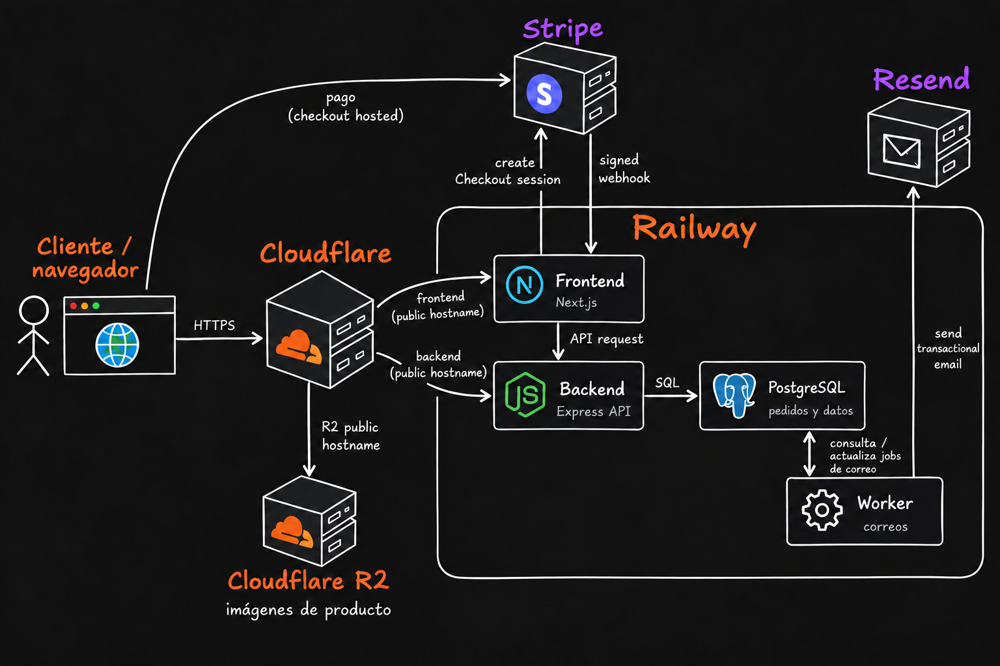
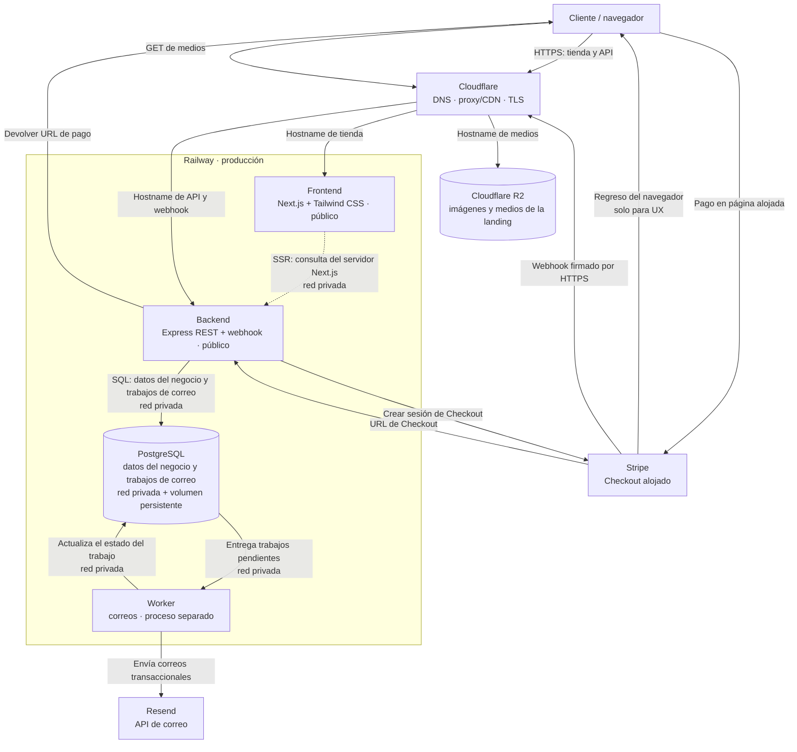
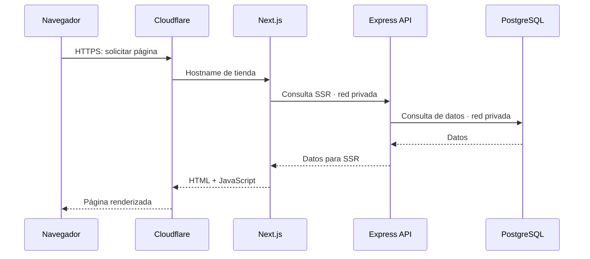
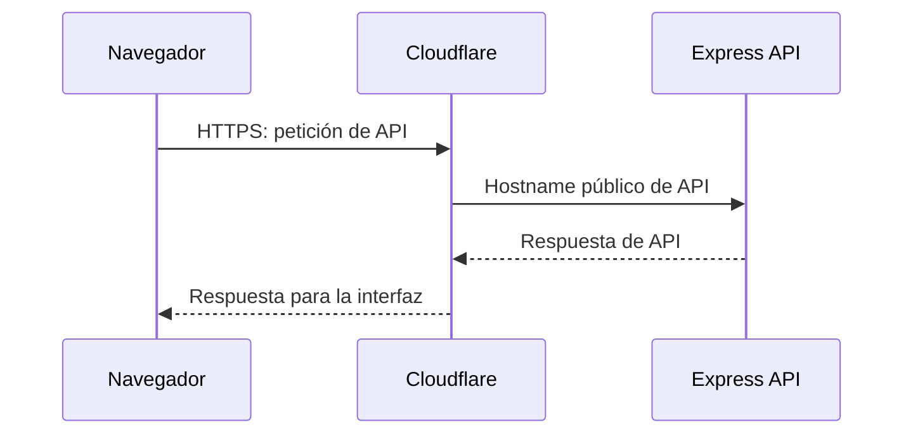

# Señor del Mictlán



Señor del Mictlán reúne mezcales de agave Cupreata silvestre y destilados procedentes de Etúcuaro, Michoacán. Este repositorio contiene el desarrollo de su tienda en línea, landing y catálogo digital.

La arquitectura combina Next.js, React y Tailwind CSS para la experiencia web; una API REST construida con Express; y PostgreSQL con Prisma ORM para los datos de usuarios, productos, carritos, pedidos y trabajos de correo. Stripe Checkout gestiona el pago alojado y el backend valida los webhooks firmados de Stripe. Un worker de Node.js procesa los trabajos de correo guardados en PostgreSQL y solicita su envío mediante Resend.

La arquitectura de producción prevista utiliza Railway para alojar el frontend, la API, el worker y PostgreSQL. Cloudflare proporciona DNS, proxy, CDN y TLS para los hostnames públicos; Cloudflare R2 almacena y sirve las imágenes de productos y los medios de la landing. Durante el renderizado del servidor, Next.js consulta la API por la red privada. Las interacciones del navegador llegan a la API mediante su hostname público.

El entorno local de desarrollo se construye con Docker Compose e incluye frontend, backend, PostgreSQL, worker y Mailpit para probar correo. Las guías del repositorio documentan el stack, la infraestructura, el despliegue y las decisiones de servicios y costos.


## Stack

| Área | Tecnología | Responsabilidad |
|---|---|---|
| Frontend | Next.js, React y Tailwind CSS 4 | Interfaz de la tienda, landing y catálogo público |
| Backend | Node.js y Express | API REST, autenticación, reglas de negocio y webhooks de Stripe |
| Base de datos | PostgreSQL en Railway | Usuarios, productos, carritos, pedidos y trabajos de correo |
| ORM y migraciones | Prisma ORM y Prisma Migrate | Acceso a PostgreSQL y migraciones versionadas del esquema |
| Tareas asíncronas | PostgreSQL | Guardar los trabajos de correo pendientes para que el worker los procese |
| Worker | Node.js en Railway | Leer y actualizar los trabajos en PostgreSQL y solicitar el envío a Resend |
| Pagos | Stripe Checkout | Checkout alojado y notificaciones firmadas de pago |
| Correo | Resend | Correos transaccionales, como recuperación de contraseña y confirmación de pedidos |
| Medios | Cloudflare R2 | Almacenar y entregar imágenes de producto y medios de la landing |
| Capa pública | Cloudflare Free | DNS autoritativo; proxy/CDN y TLS para hostnames configurados como *Proxied*; WAF, protección DDoS y Bot Fight Mode (requiere habilitación) |
| Despliegue | Railway | Alojar frontend, backend, worker y PostgreSQL |

## Documentación

- [Alcance funcional del MVP](docs/MVP_SCOPE.md) y [roadmap con el estado de las fases](docs/ROADMAP.md).
- [Desarrollo local con Docker Compose](docs/docker/guia-de-construccion-docker-compose.md).
- [Mapa de implementación de Cloudflare](docs/cloudflare/implementacion.md) y [guía de R2 e inventario de medios](docs/cloudflare/r2.md).
- [Contratos del catálogo](docs/contracts/catalogo-landing.md) y [contador de visitas](docs/contracts/visitas-landing.md).
- [Servicios, cuotas y costos](docs/servicios-y-costos.md).
- Pruebas E2E opcionales con Playwright, previstas para la aceptación de fase 08: `docker compose run --build --rm frontend-e2e`.

## Arquitectura

El diagrama muestra las conexiones entre el navegador, Cloudflare, Railway y los servicios externos. Cloudflare se conectará cuando se configure el dominio; al inicio, *staging* puede usar las URL de Railway.



### Flujos principales

Los recorridos se muestran por separado para distinguir la carga SSR de las peticiones que el navegador envía directamente a la API.

#### Carga de una página renderizada por servidor



#### Interacción que requiere la API



- Express comprueba que los productos sigan activos y usa sus precios vigentes; PostgreSQL conserva el pedido y sus datos históricos. El MVP no comprueba existencias.
- Express crea la sesión de Stripe y devuelve al navegador la URL para abrir el Checkout alojado.
- El backend verifica el webhook firmado de Stripe y actualiza el pedido en PostgreSQL. Después registra el trabajo de correo correspondiente en PostgreSQL; el worker consulta los trabajos pendientes, actualiza su estado y envía el correo mediante Resend. El redirect de regreso sirve para mostrar el resultado al cliente, pero no es prueba de pago.
- El navegador obtiene las imágenes de producto y los medios de la landing mediante Cloudflare R2. PostgreSQL conserva referencias y metadatos, no los archivos.

## Ramas y despliegues

La rama predeterminada del repositorio en GitHub es `develop`, que integra los cambios y despliega a staging. `main` corresponde a producción.

GitHub tiene activada la opción **Automatically delete head branches**: al fusionar un pull request, elimina automáticamente su rama de origen.

```text
feature/* ── pull request ──> develop ──> Railway staging
                                  │
                           pull request
                                  ↓
                                main ──> Railway producción
```

## Clonar y configurar el repositorio

Se requiere Git, Docker Engine y Docker Compose. Desde la carpeta donde guardarás el proyecto:

Para entender o reproducir la construcción de la infraestructura local desde cero, consulta la [guía de construcción con Docker Compose](docs/docker/guia-de-construccion-docker-compose.md). Si clonaste la aplicación actual, usa los archivos ya incluidos y sigue los comandos de esta sección.

```bash
git clone https://github.com/sadamlg/sr_del_mictlan_mezcal.git
cd sr_del_mictlan_mezcal
cp .env.example .env
```

`.env.example` contiene valores de desarrollo locales. `.env` está excluido de Git; conserva allí sólo credenciales de desarrollo y nunca agregues secretos reales al repositorio.

### Iniciar el entorno

Valida la configuración y construye e inicia los servicios en segundo plano:

```bash
docker compose config --quiet
docker compose up --build --detach --wait --wait-timeout 180
docker compose ps
```

La opción `--build` reconstruye las imágenes antes de iniciar los contenedores.

Docker Compose construye las imágenes del frontend y backend, y levanta frontend, API, PostgreSQL, worker de correos y Mailpit. `--wait` espera los health checks de los servicios. Los procesos de desarrollo se ejecutan dentro de sus contenedores: el frontend con `npm run dev`, el backend genera Prisma Client y arranca Node con observación de cambios, y el worker con `npm run worker:dev`. No hace falta instalar Node.js en el anfitrión ni iniciar esos procesos manualmente.

| Servicio | Dirección local |
|---|---|
| Tienda frontend | [http://localhost:3000](http://localhost:3000) |
| API; comprobar salud | [http://localhost:4000/health](http://localhost:4000/health) |
| API; catálogo público | [http://localhost:4000/api/catalog/products](http://localhost:4000/api/catalog/products) |
| API; contador de visitas | [http://localhost:4000/api/visits](http://localhost:4000/api/visits) |
| Mailpit; bandeja de correo de desarrollo | [http://localhost:8025](http://localhost:8025) |
| PostgreSQL | `localhost:5432` |

Para consultar la salida de los servicios, ejecuta `docker compose logs --follow`; Ctrl+C deja los contenedores en ejecución. Para detenerlos:

```bash
docker compose down
```

Este comando conserva los volúmenes locales de PostgreSQL. `docker compose down -v` también los elimina y borra los datos locales.
