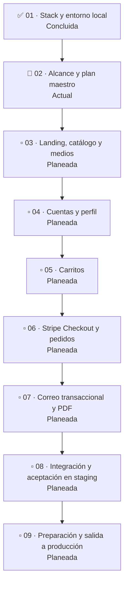

# Roadmap de desarrollo

Este roadmap ordena la construcción del MVP definido en [MVP_SCOPE.md](MVP_SCOPE.md). Cada fase se trabaja en un chat y se cierra con su resultado revisable y sus verificaciones; el orden puede ajustarse si una dependencia real lo exige, sin ampliar por ello el alcance funcional.

## Mapa de fases

**Leyenda:** ✅ concluida · 🔵 actual · ▫️ planeada. El mapa resume el orden y el estado; los resultados, dependencias y criterios de cierre se detallan en cada fase.

## Fases

### 01. Stack y entorno local — concluida

- **Dependencias:** ninguna.
- **Resultado esperado:** arquitectura y stack definidos; frontend, API, PostgreSQL, worker y Mailpit disponibles en el entorno local con Docker Compose y sus guías.
- **Criterio de cierre:** el entorno local y la documentación base permiten continuar el desarrollo desde una copia limpia del repositorio.

### 02. Alcance y plan maestro — actual

- **Dependencias:** fase 01.
- **Resultado esperado:** contrato funcional aprobado, instrucciones duraderas del repositorio, roadmap ordenado y guía de Cloudflare coherente con el momento de integración de medios.
- **Criterio de cierre:** `docs/MVP_SCOPE.md`, `AGENTS.md`, este roadmap y la guía de Cloudflare concuerdan; quedan identificadas las dependencias y los criterios de cierre de las fases.

### 03. Landing, catálogo y medios

- **Dependencias:** fases 01 y 02.
- **Resultado esperado:** landing y escaparate de productos activos implementados con la identidad visual, el aviso de mayoría de edad y los medios correspondientes. Los datos del catálogo y la carga de archivos se mantienen manualmente.
- **Cloudflare R2:** durante esta fase, justo antes de integrar archivos reales, el responsable del proyecto crea y configura la cuenta de Cloudflare. R2 se prepara para desarrollo/staging por separado de producción. `r2.dev` puede usarse sólo en entornos no productivos; no se configura DNS ni un dominio personalizado como parte de la integración local de R2.
- **Criterio de cierre:** la landing y el escaparate cumplen el alcance; los productos activos y sus medios se muestran correctamente y el aviso de edad funciona. Las claves estables y metadatos de medios se pueden resolver a partir de la configuración del entorno.

### 04. Cuentas y perfil

- **Dependencias:** fases 01 y 02; las pantallas se integran con las superficies definidas en fase 03.
- **Resultado esperado:** registro con validación de mayoría de edad y dirección, inicio/cierre de sesión, recuperación de contraseña, edición de datos personales y vista “Mis pedidos”.
- **Criterio de cierre:** los recorridos de cuenta incluidos en el alcance funcionan de extremo a extremo, con validaciones y pruebas correspondientes.

### 05. Carritos

- **Dependencias:** fases 03 y 04.
- **Resultado esperado:** carrito de invitado persistente y carrito de cuenta, mostrados como conjuntos independientes; conservar el conjunto invitado al autenticarse y permitir preparar cada conjunto por separado.
- **Criterio de cierre:** cada conjunto conserva sus artículos, cantidades, totales y acción de pago sin fusionarse; los productos inactivos o con precio cambiado se revalidan antes del pago. No se comprueban ni reservan existencias.

### 06. Stripe Checkout y pedidos

- **Dependencias:** fases 03, 04 y 05.
- **Resultado esperado:** pago alojado en Stripe, confirmación mediante webhook firmado y una orden independiente por cada conjunto pagado.
- **Criterio de cierre:** el precio y estado activo se vuelven a validar; sólo el webhook firmado confirma el pago; la orden queda guardada y visible en “Mis pedidos”. La aplicación no almacena el número completo ni el código de seguridad de la tarjeta.

### 07. Correo transaccional y PDF

- **Dependencias:** fase 06 y worker con trabajos persistidos en PostgreSQL.
- **Resultado esperado:** correos de recuperación de contraseña y confirmación de compra. Cada compra confirmada incluye exactamente el comprobante de pago y la copia de la orden en PDF.
- **Criterio de cierre:** los trabajos se guardan y procesan con el worker; los correos y sus dos adjuntos se generan para las condiciones acordadas, con reintentos y errores verificables.

### 08. Integración y aceptación en staging

- **Dependencias:** fases 03 a 07.
- **Resultado esperado:** servicios desplegados y configurados en staging para verificar los recorridos completos con Stripe en modo de prueba, correo y medios no productivos. Se configura aquí la capa pública de Cloudflare necesaria para staging, si corresponde.
- **Criterio de cierre:** los criterios de terminado del MVP están verificados en staging; los fallos y limitaciones conocidos tienen resolución antes de producción. Los medios y datos de staging están separados de producción.

### 09. Preparación y salida a producción

- **Dependencias:** fase 08 y revisión de los requisitos operativos vigentes de cada proveedor.
- **Resultado esperado:** servicios, secretos, copias de seguridad, monitoreo y medios de producción preparados; configuración de dominio, DNS, TLS y hostname público de medios aplicada sólo en esta fase cuando el dominio esté disponible.
- **Criterio de cierre:** la configuración de producción se valida sin depender de `r2.dev`; los servicios y las integraciones críticas se comprueban con los procedimientos de recuperación y operación documentados. La salida efectiva se realiza con autorización explícita del responsable.

## Reglas de ejecución

- Cada módulo de producto aplica TDD a su lógica y completa la parte de frontend correspondiente antes de avanzar al siguiente módulo.
- La validación final de un módulo combina sus pruebas con verificaciones de aceptación del recorrido completo; una interfaz sin comportamiento conectado no cierra una función.
- Agregar o reemplazar medios dentro de las superficies aprobadas es trabajo de contenido/presentación y no requiere modificar el alcance por sí solo. Revisar `docs/MVP_SCOPE.md` sólo si cambia una página, un flujo, una capacidad de usuario o una inclusión/exclusión funcional.
- Las tareas asíncronas se guardan en PostgreSQL y las procesa el worker; no se incorpora Redis ni BullMQ.
