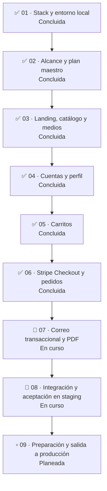

# Roadmap

Estado de implementación del [MVP aprobado](MVP_SCOPE.md). Las decisiones duraderas de desarrollo están en [AGENTS.md](../AGENTS.md); este roadmap evita repetirlas.

| Fase | Resultado | Estado |
|---|---|---|
| 01 · Stack y entorno local | Next.js, Express, PostgreSQL, Prisma, worker y Compose | Concluida |
| 02 · Alcance y plan | Contratos funcionales y arquitectura | Concluida |
| 03 · Landing, catálogo y medios | Landing, contador, aviso de edad e imágenes en R2 | Concluida |
| 04 · Cuentas y perfil | Registro, correo, sesión, perfil y seguridad | Concluida |
| 05 · Carritos | Persistencia, carrito invitado y transferencia | Concluida |
| 06 · Stripe Checkout y pedidos | Pago alojado, webhook firmado e historial | Concluida |
| 07 · Correo de compra y PDF | Resend y detalle del pedido en PDF por compra pagada | En curso |
| 08 · Integración en staging | Configuración no productiva, aceptación y Turnstile | En curso |
| 09 · Preparación de producción | Servicios, medios, operación y salida autorizada | Planeada |

## Mapa de fases

El mapa refleja la secuencia de trabajo; el estado detallado y la evidencia actual se describen abajo.

## Orden para reproducir las integraciones

1. **Fases 01–03:** construye o levanta el [entorno local con Docker](docker/guia-de-construccion-docker-compose.md) y prepara los [medios locales o R2 no productivo](services/R2.md).
2. **Fases 04–06:** prueba cuentas y correo local en Mailpit; después configura [Stripe CLI y su webhook local](services/STRIPE.md) para verificar Checkout y pedidos.
3. **Fase 07:** prueba el correo de compra y el PDF en Mailpit. Para envío real, identifica el DNS en [Neubox/cPanel](services/NEUBOX.md), verifica un dominio y configura la clave y remitentes del worker siguiendo [Resend](services/RESEND.md).
4. **Fase 08:** prepara las imágenes de producción y los servicios con la [guía de Railway](services/RAILWAY.md). Crea el webhook HTTPS de Stripe para staging con su propio secreto, configura medios y correo de ese entorno y acepta los recorridos completos. La [capa pública de Cloudflare](services/CLOUDFLARE.md) se configura cuando se vaya a usar un dominio propio; no es requisito para la URL pública inicial de Railway.
5. **Fase 09:** prepara recursos, claves, dominios, respaldos y recuperación de producción después de aceptar staging. No uses claves de prueba ni los datos de demostración para ventas reales.

Las guías incluyen los puntos de comprobación y los errores observados. El estado de las fases y el de cada cuenta externa deben revisarse por separado antes de continuar.

## Estado actual

- La landing, las tres fichas del catálogo local y los doce medios públicos de desarrollo están implementados. La base de datos de cada entorno debe tener sus migraciones aplicadas; el catálogo de demostración se carga manualmente con `backend/prisma/dev-showcase.sql`.
- Cuentas, confirmación de correo, cambio de contraseña, perfil y pedidos están conectados a PostgreSQL. En Compose, el worker envía correos de cuenta por SMTP a Mailpit.
- El carrito se puede usar como invitado o con cuenta. Al iniciar sesión se transfieren las cantidades sin duplicarlas.
- Stripe Checkout crea sesiones en el servidor. El backend confirma órdenes mediante webhook firmado e idempotente, conserva una instantánea de compra y sólo muestra pedidos pagados a su titular. La interfaz permite cambiar el destinatario de la compra sin modificar el perfil, consultar los datos seguros de tarjetas guardadas y volver a pedir desde el resumen.
- El webhook crea atómicamente un único trabajo de confirmación por pedido pagado. El worker envía por la API de Resend tanto los correos de compra con el detalle del pedido en PDF como los correos de cuenta en Railway; Compose usa Mailpit para las cuentas.
- La integración con la API de Resend está en el código. Para enviar desde un entorno hace falta configurar una clave y un remitente verificado; el responsable confirmó la recepción de correos de prueba en staging el 29 de octubre de 2026. La aceptación completa y la configuración de producción siguen pendientes.
- Hay Dockerfiles separados de producción y una [guía para configurar staging y producción en Railway](services/RAILWAY.md). Hay servicios de staging desplegados y se confirmó una compra de prueba; el estado de cada recurso externo debe verificarse en Railway. Producción sigue pendiente.
- Turnstile todavía no está implementado; corresponde a la fase 08.
- El repositorio no contiene configuración versionada de despliegue a Railway ni de DNS/TLS. No se puede inferir desde el código si staging o producción están publicados o configurados.

## Detalle recuperado de las fases 01 a 06

Estos resultados y criterios se conservaron del plan original. Las referencias a estados previos describen la secuencia de construcción, no una ausencia actual de funciones.

### 01. Stack y entorno local — concluida

- **Dependencias:** ninguna.
- **Resultado esperado:** arquitectura y stack definidos; frontend, API, PostgreSQL, worker y Mailpit disponibles en el entorno local con Docker Compose y sus guías.
- **Criterio de cierre:** el entorno local y la documentación base permiten continuar el desarrollo desde una copia limpia del repositorio.

### 02. Alcance y plan maestro — concluida

- **Dependencias:** fase 01.
- **Resultado esperado:** contrato funcional aprobado, instrucciones duraderas del repositorio, roadmap ordenado y guía de Cloudflare coherente con el momento de integración de medios.
- **Criterio de cierre:** `docs/MVP_SCOPE.md`, `AGENTS.md`, este roadmap y la guía de Cloudflare concuerdan; quedan identificadas las dependencias y los criterios de cierre de las fases.

### 03. Landing, catálogo y medios — concluida

- **Dependencias:** fases 01 y 02.
- **Resultado esperado:** landing y escaparate de productos activos implementados con la identidad visual, el aviso de mayoría de edad, el contador de sesiones persistente y los medios correspondientes. Los datos del catálogo y la carga de archivos se mantienen manualmente.
- **Cloudflare R2:** durante esta fase, justo antes de integrar archivos reales, el responsable del proyecto crea y configura la cuenta de Cloudflare. R2 se prepara para desarrollo/staging por separado de producción. `r2.dev` puede usarse sólo en entornos no productivos; no se configura DNS ni un dominio personalizado como parte de la integración local de R2.
- **Criterio de cierre:** la landing y el escaparate cumplen el alcance; los productos activos y sus medios se muestran correctamente y el aviso de edad funciona. Las claves estables y metadatos de medios se resuelven desde la configuración del entorno. **Verificación registrada en la fase:** se cargaron los doce medios de desarrollo en R2 y se comprobó la resolución de sus URL; la configuración activa debe revisarse en cada entorno.

### 04. Cuentas y perfil — concluida

**Verificación registrada al cerrar la fase:** las suites de backend, frontend y navegador, ESLint y el build de producción terminaron correctamente; Mailpit recibió los mensajes de registro y cambio de correo. No equivale a una ejecución nueva de esas pruebas.

- **Dependencias:** fases 01 y 02; las pantallas se integran con las superficies definidas en fase 03.
- **Resultado esperado:** registro con validación de mayoría de edad y dirección, inicio/cierre y restauración de sesión, recuperación de contraseña, edición de nombre(s), apellidos, correo, fecha de nacimiento y dirección, y las vistas de perfil y “Mis pedidos”.
- **Correo:** se envía confirmación tras el registro; el login y las vistas privadas se habilitan después de consumir el enlace. Un cambio de correo sólo se aplica después de confirmar el nuevo destino. Esta fase incorpora el trabajo persistido en PostgreSQL y activa el worker existente con Mailpit para probar los mensajes de cuenta; Resend de producción se integra en la fase 07.
- **Pedidos:** originalmente la vista mostraba un estado vacío; la fase 06 la conectó a órdenes reales.
- **Criterio de cierre:** los recorridos incluidos funcionan de extremo a extremo en Docker Compose, con validaciones del backend, pruebas automatizadas y estados de interfaz completos. Las contraseñas y tokens no se exponen en respuestas ni logs.

### 05. Carritos — concluida

- **Dependencias:** fases 03 y 04.
- **Resultado:** carrito de invitado persistente durante 30 días y carrito de cuenta en PostgreSQL. Al autenticarse, las cantidades se suman de forma idempotente y se muestra un solo carrito con precios actuales.
- **Criterio de cierre:** la transferencia resiste reintentos sin duplicar cantidades, conserva los artículos locales ante un error y muestra un solo total. El botón de pago se conectó en la fase 06. Los artículos inactivos se identifican y Checkout valida precios y disponibilidad antes de cobrar. No se comprueban ni reservan existencias.

### 06. Stripe Checkout y pedidos — concluida

- **Dependencias:** fases 03, 04 y 05.
- **Resultado esperado:** pago alojado en Stripe, confirmación mediante webhook firmado y una orden independiente por cada compra confirmada.
- **Criterio de cierre:** el precio y estado activo se vuelven a validar; sólo el webhook firmado confirma el pago; la orden queda guardada y visible en “Mis pedidos”. La aplicación no almacena el número completo ni el código de seguridad de la tarjeta.

## Próximas fases

### 07. Correo de compra y PDF

Crear un trabajo persistido por pedido pagado, enviar por Resend una confirmación con el detalle del pedido en PDF, y definir reintentos y observabilidad sin duplicar correos ante eventos repetidos. El envío se confirma con un remitente verificado en Resend y los recorridos de éxito, reintento e idempotencia verificados.

**Cierre:** contenido y PDF de detalle correctos, envío recuperable ante fallos y pruebas de los casos de éxito, reintento e idempotencia.

### 08. Integración en staging

Desplegar los servicios no productivos y configurar Stripe en modo de prueba, correo y medios aislados. Configurar Turnstile en registro e inicio de sesión, validando el token en servidor con Siteverify. Cloudflare DNS/TLS para un dominio de staging sólo se configura cuando ese dominio esté disponible.

**Cierre:** recorridos críticos aceptados en staging, incluidos tokens Turnstile válidos, ausentes e inválidos; secretos y datos separados de producción.

### 09. Preparación de producción

Preparar cuentas, secretos y recursos de producción, bucket y hostname de medios, dominios, TLS, copias de seguridad, monitoreo y procedimientos de recuperación. Consultar las tarifas vigentes antes de habilitar servicios de pago.

**Cierre:** procedimientos de operación y recuperación verificados, integraciones críticas validadas y autorización explícita antes de la salida efectiva.

## Reglas de ejecución

- Todo cambio que agregue, modifique o elimine lógica o comportamiento de producto incluye o actualiza pruebas automatizadas. Se aplica TDD: prueba que falla, implementación, prueba aprobada. No se cierra un módulo con lógica nueva validada sólo manualmente.
- Cada módulo completa su parte de frontend antes de avanzar al siguiente módulo. La validación combina pruebas unitarias o de integración en el nivel adecuado con pruebas de navegador para los recorridos críticos; una interfaz sin comportamiento conectado no cierra una función.
- Los asistentes de generación de pruebas pueden apoyar el descubrimiento y la exploración, pero las pruebas que cuentan como cobertura del proyecto deben estar revisadas, versionadas y ser reproducibles desde el repositorio.
- Agregar o reemplazar medios dentro de las superficies aprobadas es trabajo de contenido/presentación y no requiere modificar el alcance por sí solo. Revisar `docs/MVP_SCOPE.md` sólo si cambia una página, un flujo, una capacidad de usuario o una inclusión/exclusión funcional.
- Las tareas asíncronas se guardan en PostgreSQL y las procesa el worker; no se incorpora Redis ni BullMQ.
