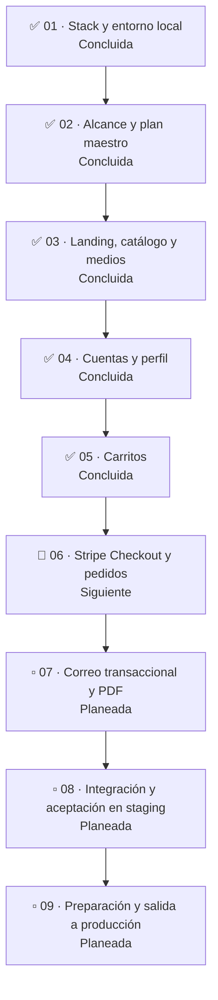

# Roadmap de desarrollo

Este roadmap ordena la construcción del MVP definido en [MVP_SCOPE.md](MVP_SCOPE.md). Cada fase se trabaja en un chat y se cierra con su resultado revisable y sus verificaciones; el orden puede ajustarse si una dependencia real lo exige, sin ampliar por ello el alcance funcional.

## Mapa de fases

**Leyenda:** ✅ concluida · 🔵 siguiente · ▫️ posterior. Las fases 03, 04 y 05 quedaron concluidas. La landing y el catálogo están implementados, las doce imágenes de desarrollo están en R2 y los componentes resuelven sus medios mediante `MEDIA_BASE_URL`. El mapa resume el orden y el estado; los resultados, dependencias y criterios de cierre se detallan en cada fase.

## Fases

### 01. Stack y entorno local — concluida

- **Dependencias:** ninguna.
- **Resultado esperado:** arquitectura y stack definidos; frontend, API, PostgreSQL, worker y Mailpit disponibles en el entorno local con Docker Compose y sus guías.
- **Criterio de cierre:** el entorno local y la documentación base permiten continuar el desarrollo desde una copia limpia del repositorio.

### 02. Alcance y plan maestro — concluida

- **Dependencias:** fase 01.
- **Resultado esperado:** contrato funcional aprobado, instrucciones duraderas del repositorio, roadmap ordenado y guía de Cloudflare coherente con el momento de integración de medios.
- **Criterio de cierre:** `docs/MVP_SCOPE.md`, `AGENTS.md`, este roadmap y la guía de Cloudflare concuerdan; quedan identificadas las dependencias y los criterios de cierre de las fases.

### 03. Landing, catálogo y medios — concluida

- **Dependencias:** fases 01 y 02.
- **Resultado esperado:** landing y escaparate de productos activos implementados con la identidad visual, el aviso de mayoría de edad, el contador de sesiones persistente y los medios correspondientes. Los datos del catálogo y la carga de archivos se mantienen manualmente.
- **Cloudflare R2:** durante esta fase, justo antes de integrar archivos reales, el responsable del proyecto crea y configura la cuenta de Cloudflare. R2 se prepara para desarrollo/staging por separado de producción. `r2.dev` puede usarse sólo en entornos no productivos; no se configura DNS ni un dominio personalizado como parte de la integración local de R2.
- **Criterio de cierre:** la landing y el escaparate cumplen el alcance; los productos activos y sus medios se muestran correctamente y el aviso de edad funciona. Las claves estables y metadatos de medios se resuelven desde la configuración del entorno. **Completado:** los doce medios de desarrollo están cargados en R2; `MEDIA_BASE_URL` está configurado en frontend y backend, y la API local devuelve las URL públicas R2 de las imágenes del catálogo.

### 04. Cuentas y perfil — concluida

**Verificación:** las suites de backend, frontend y navegador, ESLint y el build de producción terminaron correctamente. Mailpit recibió los mensajes de registro y cambio de correo.

- **Dependencias:** fases 01 y 02; las pantallas se integran con las superficies definidas en fase 03.
- **Resultado esperado:** registro con validación de mayoría de edad y dirección, inicio/cierre y restauración de sesión, recuperación de contraseña, edición de nombre(s), apellidos, correo, fecha de nacimiento y dirección, y las vistas de perfil y “Mis pedidos”.
- **Correo:** se envía confirmación tras el registro; el login y las vistas privadas se habilitan después de consumir el enlace. Un cambio de correo sólo se aplica después de confirmar el nuevo destino. Esta fase incorpora el trabajo persistido en PostgreSQL y activa el worker existente con Mailpit para probar los mensajes de cuenta; Resend de producción se integra en la fase 07.
- **Pedidos:** la vista protegida muestra un estado vacío hasta que la fase 06 cree y conecte las órdenes reales; no presenta pedidos de ejemplo.
- **Criterio de cierre:** los recorridos incluidos funcionan de extremo a extremo en Docker Compose, con validaciones del backend, pruebas automatizadas y estados de interfaz completos. Las contraseñas y tokens no se exponen en respuestas ni logs.

### 05. Carritos — concluida

- **Dependencias:** fases 03 y 04.
- **Resultado:** carrito de invitado persistente durante 30 días y carrito de cuenta en PostgreSQL. Al autenticarse, las cantidades se suman de forma idempotente y se muestra un solo carrito con precios actuales.
- **Criterio de cierre:** la transferencia resiste reintentos sin duplicar cantidades, conserva los artículos locales ante un error y muestra un solo total. El botón de pago permanece preparado para la fase 06. Los artículos inactivos se identifican y Checkout volverá a validar precios y disponibilidad antes de cobrar. No se comprueban ni reservan existencias.

### 06. Stripe Checkout y pedidos

- **Dependencias:** fases 03, 04 y 05.
- **Resultado esperado:** pago alojado en Stripe, confirmación mediante webhook firmado y una orden independiente por cada compra confirmada.
- **Criterio de cierre:** el precio y estado activo se vuelven a validar; sólo el webhook firmado confirma el pago; la orden queda guardada y visible en “Mis pedidos”. La aplicación no almacena el número completo ni el código de seguridad de la tarjeta.

### 07. Correo transaccional y PDF

- **Dependencias:** fase 06 y worker con trabajos persistidos en PostgreSQL.
- **Resultado esperado:** integrar Resend para los mensajes transaccionales y enviar la confirmación de compra. Los mensajes de registro, cambio de correo y recuperación ya usan el worker probado con Mailpit desde la fase 04. Cada compra confirmada incluye exactamente el comprobante de pago y la copia de la orden en PDF.
- **Criterio de cierre:** los trabajos se guardan y procesan con el worker; los correos y sus dos adjuntos se generan para las condiciones acordadas, con reintentos y errores verificables.

### 08. Integración y aceptación en staging

- **Dependencias:** fases 03 a 07.
- **Resultado esperado:** servicios desplegados y configurados en staging para verificar los recorridos completos con Stripe en modo de prueba, correo y medios no productivos. Se configura aquí la capa pública de Cloudflare necesaria para staging y Turnstile en modo administrado para registro e inicio de sesión; el backend valida los tokens con Siteverify.
- **Criterio de cierre:** los criterios de terminado del MVP están verificados en staging; los formularios de registro e inicio de sesión aceptan tokens válidos y rechazan tokens ausentes o inválidos; los fallos y limitaciones conocidos tienen resolución antes de producción. Los medios y datos de staging están separados de producción.

### 09. Preparación y salida a producción

- **Dependencias:** fase 08 y revisión de los requisitos operativos vigentes de cada proveedor.
- **Resultado esperado:** servicios, secretos, copias de seguridad, monitoreo y medios de producción preparados; configuración de dominio, DNS, TLS y hostname público de medios aplicada sólo en esta fase cuando el dominio esté disponible.
- **Criterio de cierre:** la configuración de producción se valida sin depender de `r2.dev`; los servicios y las integraciones críticas se comprueban con los procedimientos de recuperación y operación documentados. La salida efectiva se realiza con autorización explícita del responsable.

## Reglas de ejecución

- Todo cambio que agregue, modifique o elimine lógica o comportamiento de producto incluye o actualiza pruebas automatizadas. Se aplica TDD: prueba que falla, implementación, prueba aprobada. No se cierra un módulo con lógica nueva validada sólo manualmente.
- Cada módulo completa su parte de frontend antes de avanzar al siguiente módulo. La validación combina pruebas unitarias o de integración en el nivel adecuado con pruebas de navegador para los recorridos críticos; una interfaz sin comportamiento conectado no cierra una función.
- Los asistentes de generación de pruebas pueden apoyar el descubrimiento y la exploración, pero las pruebas que cuentan como cobertura del proyecto deben estar revisadas, versionadas y ser reproducibles desde el repositorio.
- Agregar o reemplazar medios dentro de las superficies aprobadas es trabajo de contenido/presentación y no requiere modificar el alcance por sí solo. Revisar `docs/MVP_SCOPE.md` sólo si cambia una página, un flujo, una capacidad de usuario o una inclusión/exclusión funcional.
- Las tareas asíncronas se guardan en PostgreSQL y las procesa el worker; no se incorpora Redis ni BullMQ.
