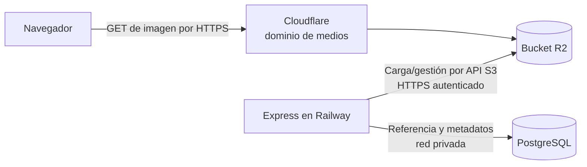

# R2 para medios y catálogo

> Guía general para preparar el almacenamiento de objetos antes de cargar el catálogo. Los nombres de buckets, dominios, claves y variables son ejemplos conceptuales; se definirán durante el desarrollo.

## Cómo encaja R2

R2 está dentro de la misma cuenta y dashboard de Cloudflare que administra DNS y el proxy, pero es un producto que se activa por separado. Para usarlo hay que completar la activación de R2 en **Storage & databases → R2**. El dashboard permite administrar buckets y objetos; también se pueden usar herramientas compatibles con S3. [Inicio de R2](https://developers.cloudflare.com/r2/get-started/)

El recorrido previsto tiene dos partes distintas:

El navegador recibe una URL pública para leer una imagen directamente desde Cloudflare/R2. Express administra la relación entre el catálogo, PostgreSQL y los objetos. Si el ecommerce permite subir archivos, Express puede escribirlos en R2 desde el servidor. Leer una imagen pública no requiere exponer las credenciales de escritura.

## Pasos, en orden

### 1. Acordar qué se guardará

Antes de cargar medios en volumen, definir:

- cuáles son imágenes públicas y cuáles deben ser privadas;
- qué variantes se necesitan para catálogo, producto y landing;
- cómo se identificará cada objeto y qué metadatos del catálogo se conservarán en PostgreSQL.

**Recomendación:** guardar en PostgreSQL la clave del objeto —por ejemplo, una ruta como `products/<id>/front.webp`—, el texto alternativo y el orden de visualización. Construir la URL completa a partir de una variable de entorno como `MEDIA_BASE_URL`. De ese modo se puede cambiar el hostname sin reescribir todas las referencias.

### 2. Activar R2 y crear el bucket de prueba

En el dashboard, abrir **Storage & databases → R2 → Overview** y completar la activación de R2. Crear primero un bucket de prueba o *staging*; los buckets son privados por defecto y el acceso público requiere habilitarse explícitamente. [Crear buckets](https://developers.cloudflare.com/r2/buckets/create-buckets/)

Separar los buckets de *staging* y producción reduce el riesgo de que pruebas o cargas de prueba modifiquen los medios públicos del entorno real. El bucket de producción se crea cuando llegue esa fase.

### 3. Elegir cómo se cargan los archivos

- Para revisar y administrar unos pocos objetos se puede usar el dashboard.
- Para una carga repetible o masiva se puede elegir una herramienta de línea de comandos o compatible con S3.
- Si más adelante se habilita la carga desde el ecommerce, el backend Express será quien escriba en R2. La interfaz y el flujo de permisos se definirán en esa fase.

R2 tiene un API compatible con S3. Para crear credenciales, se puede limitar el permiso **Object Read & Write** a buckets específicos. No se necesita entregar a la aplicación un token administrador de toda la cuenta. [Autenticación y permisos de R2](https://developers.cloudflare.com/r2/api/tokens/), [API de R2](https://developers.cloudflare.com/r2/api/)

### 4. Publicar únicamente los medios que deben ser públicos

- Para un test temporal se puede habilitar la URL administrada `r2.dev`; Cloudflare la limita y la destina a tráfico no productivo.
- Para producción, conectar al bucket un dominio propio, por ejemplo `media.<dominio>`. Ese dominio debe existir como zona en la **misma cuenta de Cloudflare** que el bucket. La conexión se realiza desde la configuración del bucket en R2 y Cloudflare crea el registro DNS correspondiente.
- Una vez conectado, ese dominio sirve los objetos públicamente. Usar un bucket público sólo para contenido destinado a mostrarse a visitantes; no guardar ahí documentos privados.

El dominio personalizado permite usar el caché de Cloudflare. La URL `r2.dev` no ofrece caché, WAF ni gestión de bots, y no debe usarse como origen de producción. [Buckets públicos, dominios y `r2.dev`](https://developers.cloudflare.com/r2/buckets/public-buckets/)

### 5. Conectar la aplicación desplegada en Railway

Hay dos configuraciones distintas:

| Necesidad | Configuración |
|---|---|
| **Mostrar imágenes públicas** | La aplicación genera la URL desde `MEDIA_BASE_URL`. El navegador solicita el archivo al dominio de medios de Cloudflare; no necesita credenciales S3. |
| **Subir o modificar objetos desde el backend** | Express usa el API S3 de R2 con un token limitado al bucket del entorno. El endpoint tiene el formato `https://<ACCOUNT_ID>.r2.cloudflarestorage.com`. Las claves se guardan como variables privadas del servicio Express en Railway. |

Usar credenciales distintas para *staging* y producción. No poner claves de R2 en el frontend, en variables `NEXT_PUBLIC_*` ni en el repositorio. Si más adelante se permite que el navegador suba archivos directamente, diseñar ese permiso por separado con credenciales de alcance y duración limitados; no reutilizar una clave permanente del backend.

### 6. Guardar referencias en PostgreSQL

PostgreSQL conserva la referencia al objeto y los metadatos del catálogo; el archivo binario permanece en R2. Mantener el hostname base en configuración por entorno y usar claves estables en los registros. Evitar guardar como dato definitivo una URL temporal de `r2.dev`.

### 7. Verificar antes de cargar el catálogo completo

- Subir un archivo de prueba y leerlo desde su URL pública esperada.
- Confirmar que la clave guardada en PostgreSQL produce la URL correcta en *staging*.
- Comprobar que el bucket de prueba y el de producción no comparten credenciales.
- Revisar que las credenciales no estén en el navegador, en el repositorio ni en logs.
- Repetir la prueba con el dominio personalizado antes de preparar producción.

Las cuotas y tarifas vigentes de R2 están resumidas en [Servicios y costos](../servicios-y-costos.md); revalídalas antes de activar producción.
