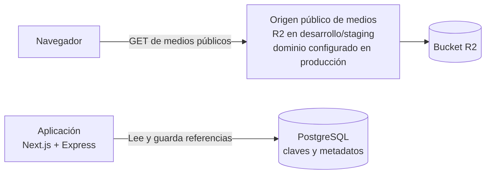

# R2 para medios y catálogo

> Guía para preparar el almacenamiento de objetos destinado a medios del catálogo y la landing. Los nombres de buckets, dominios, claves y credenciales se definen al preparar cada entorno; esta guía no implica que exista una cuenta o recurso provisionado.

## Cómo encaja R2

R2 almacena los archivos binarios; PostgreSQL conserva sus claves estables y metadatos. La aplicación usa `MEDIA_BASE_URL`, configurable por entorno, para construir la dirección pública de los medios. No se define un alias paralelo `R2_PUBLIC_BASE_URL`.

Los medios son públicos únicamente si están destinados a visitantes. No se deben almacenar documentos privados en un bucket público. La carga de medios del MVP es manual; el navegador y la aplicación no reciben credenciales de escritura de R2.

## Pasos, en orden

### 1. Identificar los medios

Antes de cargarlos, definir:

- cuáles están destinados a visitantes y cuáles deben permanecer privados;
- qué variantes se necesitan para la landing y el escaparate;
- cómo se identificarán los archivos y qué metadatos mostrará el catálogo.

Guardar en PostgreSQL una clave estable del objeto —por ejemplo, una ruta relativa asociada al producto—, texto alternativo, orden y demás metadatos del catálogo. No guardar una URL temporal de `r2.dev` como referencia definitiva.

### 2. Crear la cuenta y activar R2 en desarrollo/staging

La cuenta de Cloudflare se crea durante la fase 03 —landing, catálogo y medios—, justo antes de integrar R2 con archivos reales. La persona responsable la crea bajo control del proyecto y activa autenticación multifactor. Esta guía no requiere crearla durante la fase documental.

- Activar R2 desde **Storage & databases → R2** y crear primero un bucket para desarrollo/staging.
- Mantener el bucket de producción separado y crearlo al preparar producción.
- Los buckets son privados por defecto; habilitar acceso público sólo para medios que deban mostrarse a visitantes. [Crear buckets](https://developers.cloudflare.com/r2/buckets/create-buckets/)

### 3. Cargar los archivos manualmente

Para el MVP, la persona responsable carga los medios desde el dashboard de Cloudflare. La aplicación no incluye interfaz de administración ni carga de archivos. Mientras la carga sea manual, no hacen falta credenciales de escritura de R2 en Express, Next.js ni el navegador.

Si en el futuro se solicita una función para que la aplicación cargue o modifique objetos, primero habrá que definir ese flujo y revisar el alcance y sus permisos. No reutilizar credenciales personales o de administrador de cuenta.

### 4. Publicar sólo medios destinados a visitantes

- En desarrollo/staging puede habilitarse la URL administrada `r2.dev` para pruebas no productivas. Está limitada y no se usa en producción.
- En producción, los medios públicos usan un dominio personalizado conectado al bucket cuando el dominio real esté disponible. Esa configuración pertenece a la fase de producción, no a la integración local de R2.
- No hacer cambios de DNS ni configurar dominios personalizados como parte de la preparación local de R2.
- Si un archivo debe ser privado, no habilitar acceso público para exponerlo. Su publicación requeriría un diseño de acceso separado.

El dominio personalizado permite usar el caché de Cloudflare. `r2.dev` no ofrece caché, WAF ni gestión de bots y no debe usarse como origen de producción. [Buckets públicos, dominios y `r2.dev`](https://developers.cloudflare.com/r2/buckets/public-buckets/)

### 5. Conectar las referencias de la aplicación

Cuando se implemente el catálogo, la aplicación construirá la URL de un medio público a partir de `MEDIA_BASE_URL` y su clave estable. Configurar esa base por entorno con el origen que realmente se haya preparado; no fijar un dominio supuesto en el repositorio. PostgreSQL guarda la clave y los metadatos, no una URL temporal.

| Necesidad | Configuración |
|---|---|
| Mostrar imágenes o video públicos | `MEDIA_BASE_URL` más la clave del objeto guardada en PostgreSQL. El navegador solicita el archivo sin credenciales S3. |
| Cargar medios durante el MVP | Carga manual desde el dashboard; no se configura credencial de escritura en la aplicación. |

### 6. Verificar antes de cargar el catálogo completo

- Cargar un archivo representativo y confirmar que sólo el contenido destinado a visitantes sea público.
- Comprobar que una clave estable produce la dirección correcta desde `MEDIA_BASE_URL` en desarrollo/staging.
- Confirmar que staging no use el bucket de producción y que PostgreSQL no guarde URLs temporales.
- Revisar que no se hayan agregado credenciales de R2 al frontend, al backend o al repositorio para una carga manual.
- Validar el dominio personalizado de medios sólo cuando corresponda a staging o producción y el dominio real esté disponible.

Consulta las [cuotas y tarifas de R2](../servicios-y-costos.md) antes de activar servicios para un entorno real y vuelve a verificar las instrucciones vigentes del proveedor al configurar cada cuenta.
